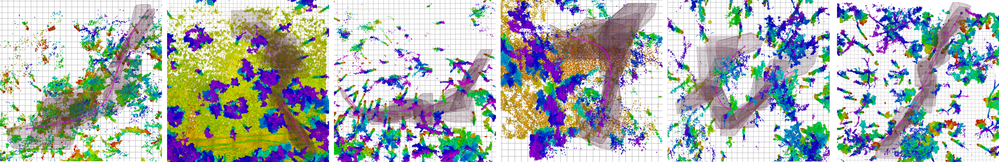
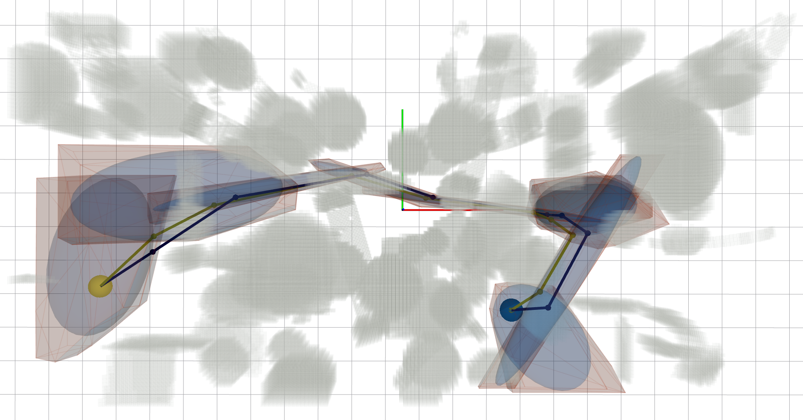
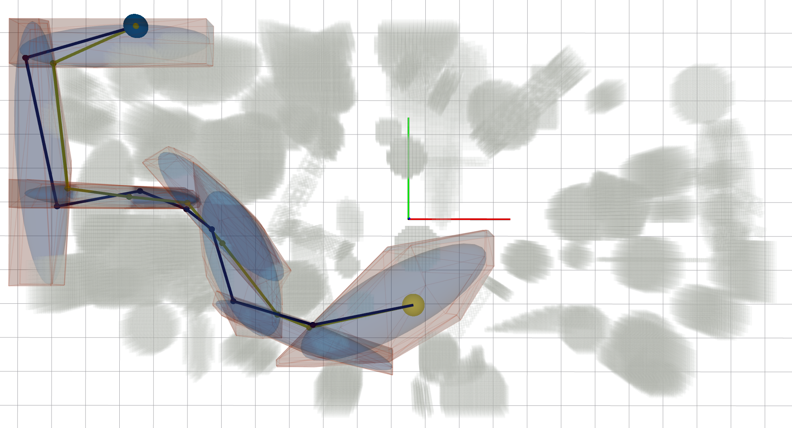
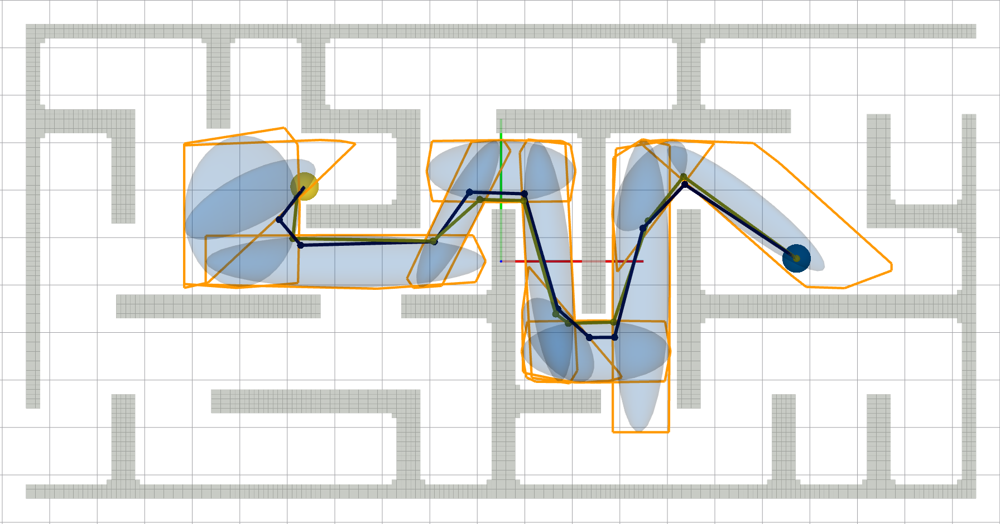
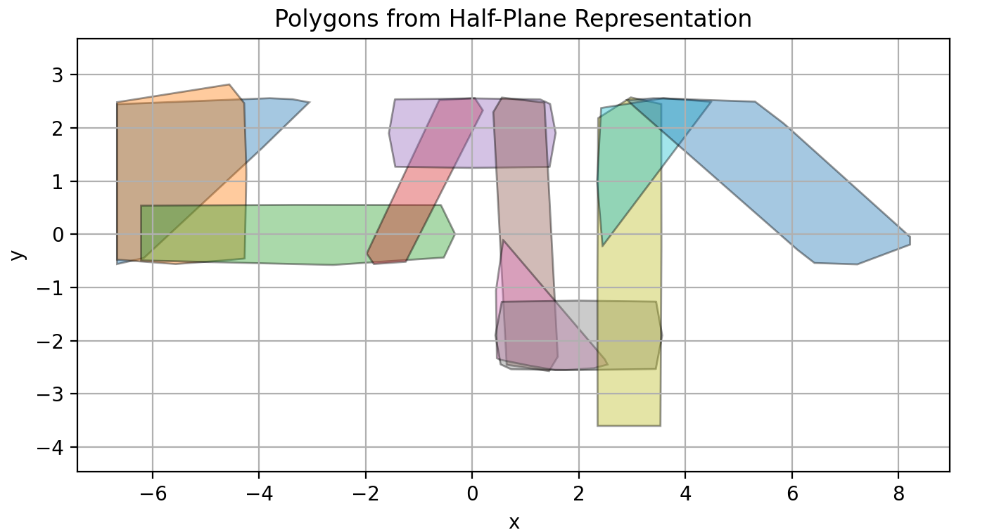

# Convex Cover of Collision-free Space for Trajectory Generation

<p align="left">
  <a href="LICENSE"></a>
  <a href="https://wiki.ros.org/noetic"></a>
  <a href="https://ieeexplore.ieee.org/document/10935632"></a>
  <a href="https://arxiv.org/abs/2604.26626"></a>
  <a href="https://youtu.be/k7CI7-fgSXE"></a>
</p>

<p align="center">
  
</p>

Optimization approximation of collision-free space as convex polytopes, for use as safe flight corridors in trajectory generation.

## Table of Contents

- [Packages](#packages)
- [Related Papers](#related-papers)
- [Getting Started](#getting-started)
  - [Run in Docker](#run-in-docker)
  - [Build from Source](#build-from-source)
  - [Run opt_sfc](#run-opt_sfc)
  - [Run star_filter](#run-star_filter)
- [Dataset Generation](#dataset-generation)
- [Acknowledgements](#acknowledgements)
- [Maintenance](#maintenance)

## Packages

| Package | Paper | Depends on | Description |
| --- | --- | --- | --- |
| [`opt_sfc`](opt_sfc) | RA-L 2025 | GCOPTER, OMPL | Optimization-based convex cover of collision-free space along a path/trajectory. |
| [`star_filter`](star_filter) | WAFR 2026 | `opt_sfc` | Online, receding-horizon star-shaped convex cover (`RobustStarManager`), robust to sensor noise. |

## Related Papers

1. **opt_sfc** -- Yuwei Wu, Igor Spasojevic, Pratik Chaudhari and Vijay Kumar, "Towards
   Optimizing a Convex Cover of Collision-Free Space for Trajectory Generation," in *IEEE
   Robotics and Automation Letters*, vol. 10, no. 5, pp. 4762-4769, May 2025.

   <details>
   <summary>BibTeX</summary>

   ```bibtex
   @ARTICLE{10935632,
     author={Wu, Yuwei and Spasojevic, Igor and Chaudhari, Pratik and Kumar, Vijay},
     journal={IEEE Robotics and Automation Letters},
     title={Towards Optimizing a Convex Cover of Collision-Free Space for Trajectory Generation},
     year={2025},
     volume={10},
     number={5},
     pages={4762-4769}}
   ```
   </details>

2. **star_filter** -- Yuwei Wu, Yichen Zhao, Dexter Ong and Vijay Kumar, "STAR-Filter: Efficient
   Convex Free-Space Approximation via Starshaped Set Filtering in Noisy Environments," in the
   *17th World Symposium on the Algorithmic Foundations of Robotics (WAFR)*, 2026.
   [arXiv:2604.26626](https://arxiv.org/abs/2604.26626)

   <details>
   <summary>BibTeX</summary>

   ```bibtex
   @inproceedings{wu2026starfilter,
     author={Wu, Yuwei and Zhao, Yichen and Ong, Dexter and Kumar, Vijay},
     title={{STAR-Filter}: Efficient Convex Free-Space Approximation via Starshaped Set Filtering in Noisy Environments},
     booktitle={The 17th World Symposium on the Algorithmic Foundations of Robotics (WAFR)},
     year={2026}}
   ```
   </details>

If this repo helps your research, please cite the paper(s) corresponding to the package(s) you use.

## Getting Started

### Run in Docker

<details>
<summary>Show Docker instructions</summary>

**1. Clone the repository**

```bash
git clone https://github.com/KumarRobotics/kr_opt_sfc.git
```

**2. Build the Docker image**

Replace `$(whoami)` with your local username if needed.

```bash
docker build --build-arg user_name=$(whoami) -t opt_sfc .
```

**3. Run the Docker container**

Mount your local repo inside the container to `/home/<username>/opt_sfc_ws/src/kr_opt_sfc` for development.

```bash
docker run -it \
    -v $(pwd)/kr_opt_sfc:/home/$(whoami)/opt_sfc_ws/src/kr_opt_sfc \
    --env="DISPLAY" \
    --env="QT_X11_NO_MITSHM=1" \
    --volume="/tmp/.X11-unix:/tmp/.X11-unix:rw" \
    opt_sfc
```

**4. Inside the container**, build and launch your ROS workspace:

```bash
catkin build
source devel/setup.bash
roslaunch opt_sfc sfc.launch
```

</details>

### Build from Source

The repo has been tested on 20.04 with ros-desktop-full installation.

**1. Prerequisites -- ROS and OMPL**

Follow the guidance to install [ROS](https://wiki.ros.org/ROS/Installation) and install OMPL:

```bash
sudo apt install libompl-dev
```

**2. Build on ROS**

Cloning `kr_opt_sfc` gives you both the `opt_sfc` and `star_filter` packages (this repo hosts
both, see [Packages](#packages)).

```bash
mkdir -p opt_ws/src
cd opt_ws/src
git clone git@github.com:KumarRobotics/kr_opt_sfc.git
wstool init && wstool merge kr_opt_sfc/utils.rosinstall && wstool update
cd ..
catkin build
source devel/setup.bash
```

### Run opt_sfc

**3D run**

```bash
roslaunch opt_sfc sfc.launch
```

Tune `opt_sfc/config/sfc.yaml` to test different performance. The default is normal mode; to
show each iteration, set `sfc_cover_opt:debug=true`.

<p align="center">
  
  
</p>

**2D image map run**

To generate a 2D corridor, launch the 2D projection with:

```bash
roslaunch opt_sfc sfc2d.launch
```

Use the format specified in `kr_param_map` to create a map from image inputs. An example is
saved at `opt_sfc/scripts/projected_2d.txt`; visualize it with:

```bash
python visualizer2d.py
```

<p align="center">
  
  
</p>

### Run star_filter

`star_filter` (STAR-Filter, WAFR 2026) ships two live ROS nodes built on the same
`Star::Corridor` core. Both open rviz with a static map from `param_env`, and set the query
point interactively with rviz's **2D Nav Goal** tool (publishes to `TargetTopic`, default
`/move_base_simple/goal`).

- **`single`** (`single.launch`, the main pipeline) -- calls `Star::Corridor::firiFiltered`
  directly to produce one safe-flight-corridor polytope per click (star-shaped filtering as a
  fast pre-filter, then FIRI inflation between the clicked point and a small offset above it):

  ```bash
  roslaunch star_filter single.launch
  ```

  Parameters (inflate range, path offset, FIRI iterations, target topic) are in
  `star_filter/config/single.yaml`.

- **`sconvex`** (`sconvex.launch`) -- runs `RobustStarManager`, an online roadmap of star-shaped
  regions (`star_mesh` + `star_kernel`) that persists and refines across clicks, re-running at
  `RunHz` around the last clicked point until you click a new one:

  ```bash
  roslaunch star_filter sconvex.launch
  ```

  Parameters (rate, inflate range, fallback seed point, target topic) are in
  `star_filter/config/sconvex.yaml`.

## Dataset Generation

You can save the corridor and initial route data for further planning or evaluation.

**1. Install**

```bash
sudo apt-get install libhdf5-dev
pip install h5py
```

**2. Set your path and set `save_sfc` to true**

```xml
<arg name="sfc_dataset_path" default="$(find opt_sfc)/dataset/"/>
<arg name="save_sfc" default='true'/>
```

**3. Run**

```bash
source devel/setup.bash
roslaunch opt_sfc sfc.launch
```

To run a different random map each time, set `auto_change` to true:

```xml
<param name="map/auto_change" value="true"/>
```

**4. Visualize**

In `opt_sfc/scripts`, set the dataset path and run:

```bash
python read_dataset.py
```

**5. Dataset structure (`.h5`)**

Each trial is stored under:

```
/trial_000001/
├── route          # Nx3 float64 matrix of 3D waypoints
└── polys/
    ├── poly_0000   # Mx4 float64 matrix (half-spaces: ax + by + cz + d <= 0)
    ├── poly_0001
    └── ...
/trial_<index>/
    └── ...
```

## Acknowledgements

- Evaluation environments: [kr_param_map](https://github.com/KumarRobotics/kr_param_map)
- Front-end Path Planning: [OMPL](https://ompl.kavrakilab.org/) planning library
- Planning Modules and Visualization: modules from [GCOPTER](https://github.com/ZJU-FAST-Lab/GCOPTER)

## Maintenance

For any technical issues, please contact Yuwei Wu (yuweiwu@seas.upenn.edu, yuweiwu20001@outlook.com).
